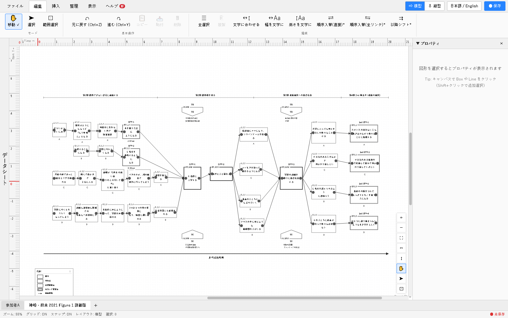

# TEMer Plus

[](https://github.com/YukiInoueNakata/temerplus/actions/workflows/deploy.yml)
[](./LICENSE)
[](https://doi.org/10.5281/zenodo.24051875)

[English](README.md) | 日本語

TEA（複線径路等至性アプローチ）で用いる、**複線径路等至性モデリング（TEM）の図を描くためのツール**です。
ブラウザで動くので、**インストールもアカウントの登録もいりません**。

**TEMer Plus を開く: https://yukiinouenakata.github.io/temerplus/**

経験の Box と、TEM に固有の点（分岐点・必須通過点・等至点・両極化した等至点など）を置き、
実現した径路・実現しなかった径路でつなぎ、非可逆的時間に沿って社会的方向づけ（SD）・
社会的助勢（SG）を加えて、**PNG / SVG / PDF / PPTX** や **論文用のレポート（Word）** に
出力できます。図のデータは手元のブラウザの中だけで処理され、サーバーへは送られません。

構成: **React + TypeScript + Vite + React Flow**（GitHub Pages で公開している静的な Web アプリ）



## なぜ作ったか

TEM の図には独自の決まりがあります。Box の種類を枠の線で示し、実現した径路と実現しなかった径路を
描き分け、社会的方向づけ・社会的助勢・時期区分を置き、非可逆的時間を一方向に流します。
これまでは PowerPoint や Illustrator で手で描くことが多く、表記をそろえること、分析が進むたびに
Box を並べ替えること、論文で表記の決まりを報告することに手間がかかっていました。
TEMer Plus は、これらの要素を構造を持ったデータ（種類、時間軸・項目軸の上の位置、Box どうしの
つながり）として扱います。そのため表記がそろい、配置を組み替えやすく、同じデータから図と
論文の方法の節の材料を作れます。同じ作者による Excel VBA 版の TEMer の後継で、TEM を使う
研究者への調査をもとに機能を決めました。TEA・TEM を使う研究者や学生（TEM の図を初めて描く人を
含む）を想定しています。

## 機能

- **TEM の要素** — Box の種類（行為・潜在的な行為・分岐点・等至点・両極化した等至点・必須通過点・
  セカンド等至点・その他）、実線と点線の径路、SD・SG（Box や矢印に付ける・Box の間・帯に置く）、
  時期ラベル、非可逆的時間の矢印、自動で作る凡例。横型と縦型。1 つのファイルに複数の図（シート）。
- **編集** — 表の形で編集するデータシート、整列・間隔の道具、元に戻す・やり直し、図の上のメモと記号、
  Box スタイルのテーマ（線種を実在性だけに使う簡素化方式を含む）。
- **取り込み** — CSV・Excel（MAXQDA のコード付きセグメントを含む）、PowerPoint（.pptx）で描いた TEM 図、
  Box と結びつけられるインタビューの逐語録。
- **出力** — PNG・SVG・PDF・PPTX・印刷（画像は約 300dpi）。含める要素の確認、用紙への収め方、
  Box の間で区切る複数ページの出力。記号体系の宣言・表記方針・図・各要素の説明をまとめた
  論文用のレポート（Word）。CSV の書き出し。
- **ファイル** — 図は `.tem`（JSON）のファイルに保存。保存していない変更はブラウザの中に自動で残ります。
- **画面の言語** — 日本語と英語をいつでも切り替えられます。図の中の文字（凡例・レポート）の言語は、図ごとに別に決めます。

すべての機能の一覧は [docs/features.ja.md](docs/features.ja.md) にあります（English: [docs/features.en.md](docs/features.en.md)）。

## はじめ方

https://yukiinouenakata.github.io/temerplus/ を **Chrome**（おすすめ）・Edge・Safari で開きます。
開くところから、図と論文用のレポートを出力するまでの手順を、画面の写真つきで
[docs/getting-started.ja.md](docs/getting-started.ja.md) にまとめています
（English: [docs/getting-started.en.md](docs/getting-started.en.md)）。

| ブラウザ | 保存のしかた |
|---|---|
| Chrome・Edge | 保存する場所を 1 回選ぶと、2 回目からは同じファイルに上書き |
| Safari・Firefox | 保存のたびに `.tem` ファイルをダウンロード |

動作を確かめた環境: Windows（Chrome・Edge）、macOS 26・Apple Silicon（Safari・Chrome）、
macOS 12・Intel（Safari・Chrome）。

講習会の資料（TEA 2026、スライドと練習用のファイル）: https://yukiinouenakata.github.io/tea2026/

## ソースから動かす

Node.js 20 以上が必要です。

```bash
cd webApp
npm ci
npm run dev        # 開発用のサーバー（http://localhost:5173/）
npm test           # 単体テスト（Vitest）
npm run build      # webApp/dist/ に静的なファイルを書き出す
```

GitHub が使えなくなっても、Zenodo に保存した各版の zip から動かせます。v0.2.6 からは組み立て済みのファイル（`release/web/`）も入っていて、Node.js が無くても静的なファイルとして配れば動きます。手順は [docs/build-from-archive.ja.md](docs/build-from-archive.ja.md) にまとめています（English: [docs/build-from-archive.en.md](docs/build-from-archive.en.md)）。

## 注意と制約

- 画面は日本語と英語を切り替えられます（右上の「日本語 / English」）。
- PPTX の出力は、位置・文字・図形をおおよそ再現します。文字の折り返しは PowerPoint が決めます。
  見た目をそろえたいときは PNG・SVG・PDF を使ってください。
- Safari で印刷するときは、印刷の画面で用紙の向きを自分で選んでください。
- 複数ページの出力では、凡例を各ページの同じ位置に置くので、図によっては Box と重なることがあります。

## 問い合わせ

- **Issues** — 不具合や要望は [GitHub Issues](https://github.com/YukiInoueNakata/temerplus/issues) へ。
  使っているパソコン（Windows・Mac と版）とブラウザ、起きたことを書いてください。
- **更新情報** — アプリの「ヘルプ」タブの「更新情報」、[個人サイトのページ](https://yukiinouenakata.github.io/programs/temer-plus/)、
  この README の下の「最近の更新」で見られます。

## ライセンスと作者

作者: 中田友貴（Yuki Inoue Nakata、[ORCID 0009-0000-4934-323X](https://orcid.org/0009-0000-4934-323X)）、
立命館大学 総合心理学部 — 設計・実装・文書

このリポジトリは **PolyForm Noncommercial License 1.0.0** で公開しています（全文は [`LICENSE`](./LICENSE)）。

- **非商用の利用は無償** — 研究・教育・個人での利用
- **商用の利用には別のライセンスが必要** — [`COMMERCIAL.md`](./COMMERCIAL.md) を見てください

## TEM を学ぶための文献

これから TEM 図を描く人のための基本の文献です。
書誌は CiNii・J-STAGE・Crossref・出版社のページで確かめました（2026 年 11 月）。

### 日本語

- サトウタツヤ・安田裕子・木戸彩恵・高田沙織・ヴァルシナー, J.（2006）．複線径路・等至性モデル：人生径路の多様性を描く質的心理学の新しい方法論を目指して　質的心理学研究，5，255–275．https://doi.org/10.24525/jaqp.5.1_255 （無料で読める） <br>
  TEM を提唱した原典です。等至点・両極化した等至点・分岐点・必須通過点・非可逆的時間を定義しています。図の各要素の意味を確かめる出発点です。
- 荒川歩・安田裕子・サトウタツヤ（2012）．複線径路・等至性モデルのTEM図の描き方の一例　立命館人間科学研究，25，95–107．https://doi.org/10.34382/00004276 （無料で読める） <br>
  TEM 図を描く手順を、具体例で一歩ずつ示しています。作図の実務にいちばん直結する資料です。
- 宮下太陽・上川多恵子・サトウタツヤ（2022）．TEM（複線径路等至性モデリング）の新たな理論的展開：記号圏とイマジネーション理論を踏まえて　立命館人間科学研究，44，49–64．https://doi.org/10.34382/00016829 （無料で読める） <br>
  「複線径路等至性モデリング」という今の呼び方と、近年の理論の展開を解説しています。
- サトウタツヤ（編著）（2009）．TEMではじめる質的研究：時間とプロセスを扱う研究をめざして　誠信書房 <br>
  TEM の最初のまとまった入門書です。理論の解説と、研究例を TEM 図とともに載せています。
- 安田裕子・滑田明暢・福田茉莉・サトウタツヤ（編）（2015）．ワードマップ TEA 理論編：複線径路等至性アプローチの基礎を学ぶ　新曜社 <br>
  TEA の主な概念を項目ごとに短く解説しています。用語の意味をひくのに向いています。
- 安田裕子・滑田明暢・福田茉莉・サトウタツヤ（編）（2015）．ワードマップ TEA 実践編：複線径路等至性アプローチを活用する　新曜社 <br>
  TEA を各領域で使った研究の実例集です。
- 安田裕子・サトウタツヤ（編著）（2022）．TEAによる対人援助プロセスと分岐の記述：保育，看護，臨床・障害分野の実践的研究　誠信書房 <br>
  保育・看護・臨床・障害の対人援助の場で TEA を使った研究を集めています。
- サトウタツヤ・安田裕子（監修）上川多恵子・宮下太陽・伊東美智子・小澤伊久美（編）（2023）．カタログTEA（複線径路等至性アプローチ）：図で響きあう　新曜社 <br>
  さまざまな研究の TEM 図を集めた見本帳です。図の見せ方の幅を知るのに向いています。

### 英語

- Valsiner, J., & Sato, T. (2006). Historically structured sampling (HSS): How can psychology's methodology become tuned in to the reality of the historical nature of cultural psychology? In J. Straub, D. Weidemann, C. Kölbl, & B. Zielke (Eds.), *Pursuit of meaning: Advances in cultural and cross-cultural psychology* (pp. 215–252). transcript Verlag. https://doi.org/10.14361/9783839402344-010 <br>
  TEM の土台になった、研究に招く人の選び方（HSS。のちに HSI）を提唱した章です。
- Sato, T., Yasuda, Y., Kido, A., Arakawa, A., Mizoguchi, H., & Valsiner, J. (2007). Sampling reconsidered: Idiographic science and the analyses of personal life trajectories. In J. Valsiner & A. Rosa (Eds.), *The Cambridge handbook of sociocultural psychology* (pp. 82–106). Cambridge University Press. https://doi.org/10.1017/CBO9780511611162.007 <br>
  TEM と HSS を英語で体系的に紹介した章です。英語で TEM を引くときの標準的な文献です。
- Sato, T., Hidaka, T., & Fukuda, M. (2009). Depicting the dynamics of living the life: The trajectory equifinality model. In J. Valsiner, P. C. M. Molenaar, M. C. D. P. Lyra, & N. Chaudhary (Eds.), *Dynamic process methodology in the social and developmental sciences* (pp. 217–240). Springer. https://doi.org/10.1007/978-0-387-95922-1_10 <br>
  TEM の概念と描き方を英語で解説した章です。図の要素の英語名を確かめるのに使えます。
- Sato, T., Mori, N., & Valsiner, J. (Eds.). (2016). *Making of the future: The trajectory equifinality approach in cultural psychology*. Information Age Publishing. <br>
  TEA を主題にした英語の論文集です。TEM の総論と、国際的な応用・拡張の章を収めています。
- Masaki, F. (2025). Self-regulated learning from a cultural psychology perspective: Shifting from strategy to process with the trajectory equifinality approach. *Human Arenas, 8*(1), 131–149. https://doi.org/10.1007/s42087-023-00326-w （無料で読める） <br>
  自己調整学習を題材に、TEA の考え方と図での描き方を英語で説明しています。
- Saito, Y., Tomori, K., Sawada, T., & Ohno, K. (2023). Longitudinal process of setting and achieving activity- and participation-level goals in home rehabilitation in Japan: A qualitative study using trajectory equifinality modeling. *International Journal of Environmental Research and Public Health, 20*(9), Article 5746. https://doi.org/10.3390/ijerph20095746 （無料で読める） <br>
  方法の節で TEM の手順（等至点の設定、分岐点・必須通過点の特定）を説明し、完成した TEM 図を載せた英語の論文です。

## 引用

このソフトウェアを使った場合は引用してください。機械で読める引用の情報は
[`CITATION.cff`](./CITATION.cff) にあります（GitHub の「Cite this repository」からも使えます）。
Zenodo に保存しています: https://doi.org/10.5281/zenodo.24051875 （すべての版。最新の v0.2.5 は https://doi.org/10.5281/zenodo.24165405 ）

```bibtex
@software{nakata_temer_plus,
  author  = {Nakata, Yuki Inoue},
  title   = {TEMer Plus: A Drawing Tool for Trajectory Equifinality Modeling (TEM)},
  year    = {2026},
  version = {0.2.6},
  doi     = {10.5281/zenodo.24051875},
  url     = {https://github.com/YukiInoueNakata/temerplus}
}
```

<!-- CHANGELOG:START -->
## 最近の更新

### 2026年11月13日

- **改善** 組み立て済みのファイルを同梱し、Zenodo の写しだけで動かす手順を書く: GitHub が使えなくなっても TEMer Plus を動かせるように、組み立て済みのファイル一式（release/web）を各版に入れ、Zenodo に保存される zip に含めるようにしました。Node.js が無くても、静的なファイルとして配れば手元や別のサーバーで動きます。手順は docs/build-from-archive.ja.md（英語版あり）にまとめ、README から辿れます。ソースから組み立てる手順と、依存のパッケージが取れなくなったときの備えも書きました。
- **改善** 横型の図の凡例を、時間の矢印の下に左寄せで置く: 凡例を自動で置くとき、横型の図では、これまで右端を時間の矢印の右端にそろえていました。これを、左端を矢印の始まりにそろえる形に変えました。縦型の図はこれまでどおり左寄せです。凡例を動かして位置を手で決めた図は動きません。

### 2026年11月12日

- **改善** 簡素化方式の凡例を「実現した」「実現しなかった」の 2 項目にする: 簡素化方式のテーマを当てると、凡例が Box と径路をまとめた 2 項目（実線＝実現した行為・径路、点線＝実現しなかった行為・径路）になります。線種が実在性だけを表すので、種別ごとの凡例は要らないためです。ほかのテーマを当てるか「すべて自動に戻す」で元の凡例に戻ります。設定の「凡例」でも切り替えられます。
- **修正** SVG の書き出しで Box の中の文字を中央に置く: SVG に書き出すと、横書きの文字が Box の上下の中央より上に寄り、縦書きの文字の列が左右の中央から右にずれていました。画面と同じく、横書きは上下の中央、縦書きは左右の中央に置くように直しました。
- **修正** SVG・PowerPoint の凡例で長いラベルが枠からはみ出さないようにする: 凡例の項目の幅を 10 字ぶんで決め打ちしていたため、長いラベルが枠からはみ出していました。いちばん長いラベルが収まる幅にしました。
- **改善** 簡素化方式のテーマを当てると、径路の線をカギ線にする: 簡素化方式（線種は実在性だけ・種別はラベル）は、線の角度や向きにも意味を持たせない表記として、径路を原則カギ線（L 字の線）で描くことにしました。テーマを当てると、新しく引く線の既定と今ある線がカギ線になります（元に戻すで戻せ、あとから線ごとに変えられます）。径路がすべてカギ線なら、論文用レポートの記号体系の宣言に「径路の線の角度や向きには意味を持たせない」と書き出します。
- **改善** 論文用レポートの記号体系の既定を「TEMerPlus の既定の表記」と呼ぶ: 記号体系の基準の選択肢「荒川・安田・サトウ 2012（既定）」を「TEMerPlus の既定の表記」に改めました。荒川ら（2012）を参照したのは実線と点線の使い分けで、等至点の二重線・必須通過点の太線など種別を表す線種は本ツールが定めたものだからです。Word のレポートに書き出す文もそのように直しました。前に作ったファイルの設定はそのまま読めます。
- **改善** Box の枠の既定の太さを揃える: テーマを当てないときの枠の太さが 1.0〜3.0 の 5 段階に分かれていたのを揃えました。1 本線の枠（行為・その他・分岐点・潜在的な行為）は 1.5、必須通過点と二重線（等至点・両極化した等至点とセカンド）は 3.0 です。線の種類は変えていません。テーマを当てていない前の図は、開くと新しい太さで描かれます。テーマを当てた図は、保存した太さのままです。
- **改善** リボンの右上にコマンドパレットのボタンを置く: これまで Ctrl+K でしか開けなかったコマンドパレット（機能を名前で探して実行する窓）を、横型・縦型のボタンの左の「コマンド」からも開けるようにしました。
- **改善** Box の種別「通常」を「行為」に、「潜在経験」を「潜在的な行為」に改める: TEA の研究者の指摘を受けて、実現した経験を表す Box を「行為」、実現しなかったがありえた経験を表す点線の Box を「潜在的な行為」と呼ぶようにしました（英語は Action・Potential action）。画面・凡例・論文用レポートの名前が変わります。前に作ったファイルはそのまま開け、種別も変わりません。CSV や MAXQDA の取り込みでは前の名前（通常・潜在経験）も読めます。文字が前の名前のままの Box は、種別を変えると新しい種別の名前に替わります。

### 2026年11月10日

- **改善** 点線の径路だけでつながる Box に注意を出す: 通常の Box に点線の径路しかつながっていないとき、Box の右上に「!」を出し、プロパティで「潜在経験にする」を選べます。潜在経験の Box に実線の径路がつながっているときは「通常にする」を勧めます。「このままにする」で以後は出しません。「!」は出力には写りません。
- **改善** 凡例を時間の矢印の右下に自動で置く: 新しい図では、凡例を時間の矢印の右下に、右端をそろえて横長に置きます。行の数は矢印の長さに収まる最も少ない数にします。図を変えると置き直し、凡例を動かすと手動になります（プロパティの凡例で自動に戻せます）。
- **改善** テーマ「カタログTEA 図 2-1 の例」: カタログTEA（2023）第 2 章 図 2-1 の描き分け（OPP は楕円、BFP は二重線、EFP は太い実線、P-EFP は太い点線、ありえた経験は細い点線）のテーマを選べます。凡例と論文用レポートの記号体系の宣言も楕円に対応しました。
- **改善** 出力で紙面での文字の大きさを確かめる: 出力の画面に、用紙に収めたときにいちばん小さい文字の大きさ（pt）を出し、7 pt 未満なら知らせます。プレビューをグレースケールで見られます。
- **改善** デモを架空の例に替えた: 起動時の案内のデモ（日本語・英語）を、架空の例「ピアノの再開」に替えました。図を開いたときは、凡例まで含めて画面に合わせます。
- **改善** 用語をカタログTEA に合わせた: 径路の線の名前を「実線径路」「点線径路」にそろえました（以前のボタンは「実線矢印」「点線矢印」）。Word のレポートの用語解説の「経路」を「径路」に直しました。
- **修正** 凡例の等至点の見本が一重の線に見える: 画面を縮めて表示すると、凡例の等至点（二重線）の見本が太い一重の線に潰れ、必須通過点と同じに見えていました。PNG・PDF の出力も同じでした。
- **修正** メモの欄の無いファイルを開くと画面が白くなる: メモ（notes）の欄が無い .tem ファイルを開くとエラーで白い画面になっていました。
- **改善** コメントを付けられるように: Box・径路・SD/SG を選ぶと、プロパティの下でコメントを付け、返信し、解決にできます。何も選んでいないときはシートのコメントの一覧が出ます。未解決のコメントがある Box・SD/SG には印が付きます（表示 > コメントで隠せます。出力には出ません）。Box の右クリックからも付けられます。
- **改善** 論文用レポートのラベルの括弧を選べる: 結果の節でラベルを括る括弧（Box・時期と SD・SG）と、記号とラベルの順（BFP1【…】／【…】（BFP1））を選べます。既定は、TEM の論文の調べで最も多かった【…】（英語の図は “…”）です。出力タブの設定は図のファイルに保存されます。
- **修正** 英語のデモを開くと「未保存」になる: 何も変えていないのに「未保存」と出ていました。
- **修正** コメントや入力で、変換の確定の Enter で送られる: 日本語の変換を確定する Enter で、返信が途中のまま送られることがありました。
- **修正** 原文ビューアを別窓に出すと、もう一方の窓の表示位置が戻る: 編集のたびに、もう一方の窓の拡大と位置が全体表示に戻っていました。
- **改善** 英語の用語を『TEAと質的探究用語集』（2025）に合わせる: 英語の画面と論文用レポートで、実線・点線の径路を Solid-line trajectory・Dotted-line trajectory に、時期区分を Time division にしました（画面の短い表示は Period のまま）。古い名前（Solid path・Dashed path など）の CSV もそのまま取り込めます。

### 2026年11月8日

- **改善** Mac ではショートカットを ⌘ で表示: ボタンやコマンドパレットのショートカットを、Mac では「⌘Z」「⇧⌘S」のように表示します。やり直しは Mac では ⇧⌘Z です。
- **修正** Shift を使うショートカットが効かないことがある: やり直し（Ctrl+Shift+Z）などが、Shift や Caps Lock の状態によって効きませんでした。
- **修正** ブラウザによって Box の文字の折り返しが変わる: Chrome・Edge は行の端のかっこ（「」）を詰めて表示し、Safari とは折り返しが変わることがありました。どのブラウザでも詰めない表示にそろえました。

### 2026年11月7日

- **改善** 複数ページの出力を作り直し: 図の始まりを 1 ページ目に合わせ、ページの境目を Box どうしの間の空いた所に置くので、Box が途中で切れません。凡例は各ページに、そのページに出てくる種類だけで付きます。図がページ数に入りきらないときは少し縮めて収め、「この図は約 3.4 ページ分です」のような目安も出ます。
- **修正** 出力で文字が枠からあふれる: 「両方に収める」などで図を用紙に合わせて縮めたとき、枠だけが縮んで文字が元の大きさのまま残っていました。文字・メモ・曲線も同じ倍率で縮めます。
- **改善** PNG・PDF・印刷を高い解像度で: 用紙の上で約 300dpi になる大きさで写します（以前の PNG は A4 で横 1170px ほどでした）。
- **修正** Safari で印刷できない: Safari では印刷用の窓がポップアップとして止められ、印刷できませんでした。用紙の向きは Safari の印刷画面で「横」を選んでください。
- **修正** 細い二重線が 1 本に見える: モノクロ（既定）・論文向けのテーマで、等至点の二重線が画面と PNG・PDF では 1 本になっていました。
- **新機能** 出力の前に、含める要素を確認: 出力プレビューで、メモ・記号・コメント・凡例・時期ラベルを図に含めるかを毎回選びます。選び終えるまで保存できません。時期ラベルが無いときや、凡例を含めないときは注意が出ます。
- **新機能** 論文用レポートの出力前の確認画面: 項目ごとの入力状況を「済・未・一部（Box の説明 37 件中 8 件 など）」で示し、「記入を続ける」か「このまま出力する」かを選べます。図にあるメモ・記号・コメントを載せるか、未入力の項目を出力に含めるかもここで選びます。
- **改善** 表記方針を 11 項目に: 論文用レポートの表記方針に、矢印の距離・Box の横幅・Box の高さ・Box の形状・フォント装飾・テキスト配置を足しました。
- **新機能** 記号の簡素化方式（線種は実在性だけ）: 設定の Box スタイルのテーマに「簡素化方式」を足しました。実線＝観察された、点線＝観察されなかった経験とし、EFP・OPP などの種別は種別ラベルで示します。論文用レポートの記号体系の宣言には、今の図の線種がそのまま書き出されます。
- **修正** Box のテーマの線種が PPTX・SVG に出ない不具合: テーマで指定した枠の線種・太さを、PPTX・SVG でも画面と同じに描くようにしました。
- **修正** 凡例・時期ラベルの出力が形式によって食い違う不具合: PNG・PDF と PPTX・SVG とで、凡例や時期ラベルが出るかどうかが食い違うことがあったのを揃えました。

それより前の更新は、アプリ（https://yukiinouenakata.github.io/temerplus/）の「ヘルプ」タブの「更新情報」で見られます。
<!-- CHANGELOG:END -->
