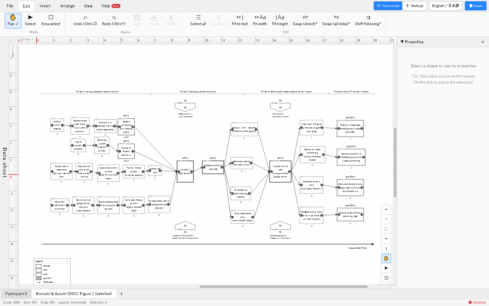

# TEMer Plus

[](https://github.com/YukiInoueNakata/temerplus/actions/workflows/deploy.yml)
[](./LICENSE)
[](https://doi.org/10.5281/zenodo.24051875)

English | [日本語版 README はこちら (Japanese)](README.ja.md)

A **drawing tool for diagrams of Trajectory Equifinality Modeling (TEM)**, used in the
Trajectory Equifinality Approach (TEA) in cultural psychology and qualitative research.
TEMer Plus runs in the browser: **no installation and no account are needed**.

**Open the app: https://yukiinouenakata.github.io/temerplus/**

Draw boxes for experiences and the TEM-specific points (bifurcation points, obligatory
passage points, equifinality points and their polarized counterparts), connect them with
realized and unrealized paths, add social direction (SD) and social guidance (SG) along
irreversible time, and export the diagram to **PNG / SVG / PDF / PPTX** or a **Word report
for a paper**. Diagrams are processed only inside your browser and are never sent to a server.

Stack: **React + TypeScript + Vite + React Flow** (a static web app on GitHub Pages).



## Statement of need

TEM diagrams follow conventions of their own: box types marked by border styles,
realized and unrealized paths, social direction and social guidance, period labels, and
irreversible time running in one direction. Researchers usually draw them by hand in
PowerPoint or Illustrator, where keeping the notation consistent, rearranging boxes as an
analysis develops, and reporting the notation in a paper all take manual work. TEMer Plus
treats these elements as structured data (types, levels on the time and item axes, links
between boxes), so the notation stays consistent, the layout can be edited and
reorganized, and the same data produce the figure and the text for a paper's method
section. It succeeds TEMer, an earlier Excel VBA tool by the same author, and its features
were shaped by a survey of TEM researchers. Target users are researchers and students
using TEA/TEM, including those who are new to drawing TEM diagrams.

## Features

- **TEM elements** — box types (action, potential action, bifurcation point,
  equifinality point, polarized equifinality point, obligatory passage point, second
  equifinality point, others), solid-line and dotted-line trajectories, SD/SG (attached to a box or an
  arrow, between boxes, or in bands), period labels, the irreversible-time arrow, and an
  automatic legend; horizontal and vertical layouts; several diagrams (sheets) per file.
- **Editing** — a data sheet for table-style editing, alignment and spacing tools,
  undo/redo, notes and symbols on the diagram, and box style themes (including a simplified
  notation in which line styles show only whether a path was observed).
- **Import** — CSV / Excel (including MAXQDA coded segments), TEM diagrams drawn in
  PowerPoint (.pptx), and interview transcripts linked to boxes.
- **Export** — PNG / SVG / PDF / PPTX / printing, at about 300 dpi for images, with a
  confirmation of what to include, fitting to the paper, and multi-page output whose page
  breaks fall between boxes; a Word report for papers with the notation declaration, the
  notation policy, the diagram, and descriptions of each element; CSV export.
- **Files** — diagrams are saved as `.tem` (JSON) files; unsaved work is kept automatically
  in the browser.
- **Interface** — Japanese and English, switchable at any time; the diagram text (legend,
  report) follows a separate per-diagram language setting.

The full list of features is in [docs/features.en.md](docs/features.en.md)
(日本語: [docs/features.ja.md](docs/features.ja.md)).

## Getting started

Open https://yukiinouenakata.github.io/temerplus/ in **Chrome** (recommended), Edge, or
Safari. A step-by-step guide with screenshots, from opening the app to exporting a diagram
and a paper report, is in [docs/getting-started.en.md](docs/getting-started.en.md)
(日本語: [docs/getting-started.ja.md](docs/getting-started.ja.md)).

| Browser | Saving |
|---|---|
| Chrome, Edge | Choose a file once; later saves overwrite it |
| Safari, Firefox | Each save downloads a `.tem` file |

Tested on Windows (Chrome, Edge), macOS 26 on Apple Silicon (Safari, Chrome) and macOS 12
on Intel (Safari, Chrome).

The interface is available in Japanese and English ("English / 日本語" at the top right). An English
demo diagram is available from the welcome screen ("Open English demo").

Workshop materials (TEA 2026, in Japanese): https://yukiinouenakata.github.io/tea2026/

## Running from source

Requires Node.js 20 or later.

```bash
cd webApp
npm ci
npm run dev        # development server at http://localhost:5173/
npm test           # unit tests (Vitest)
npm run build      # static files in webApp/dist/
```

## Notes & limitations

- PPTX export reproduces positions, text and shapes approximately; PowerPoint wraps text
  on its own. Use PNG, SVG or PDF when the exact appearance matters.
- When printing from Safari, choose the paper orientation in the print dialog yourself.
- In multi-page export, the legend is placed at the same position on every page and may
  overlap boxes in some diagrams.

## Contributing & support

- **Issues** — report bugs or request features via
  [GitHub Issues](https://github.com/YukiInoueNakata/temerplus/issues). Please include your
  computer (Windows or Mac and version), your browser, and what happened.
- **Release notes** — see the in-app Help tab ("更新情報"), the
  [project page](https://yukiinouenakata.github.io/en/programs/temer-plus/), or the
  Japanese README.

## License & attribution

Author: Yuki Inoue Nakata ([ORCID 0009-0000-4934-323X](https://orcid.org/0009-0000-4934-323X)),
College of Comprehensive Psychology, Ritsumeikan University — design, implementation, documentation.

This repository is licensed under the **PolyForm Noncommercial License 1.0.0** (full text in
[`LICENSE`](./LICENSE)).

- **Noncommercial use is free** — research, teaching, and personal use.
- **Commercial use requires a separate license** — see [`COMMERCIAL.md`](./COMMERCIAL.md).

## Further reading on TEM

A short list of basic readings for people who are about to draw TEM diagrams.
Bibliographic details were checked against CiNii, J-STAGE, Crossref, and the publishers' pages (November 2026).

### In English

- Valsiner, J., & Sato, T. (2006). Historically structured sampling (HSS): How can psychology's methodology become tuned in to the reality of the historical nature of cultural psychology? In J. Straub, D. Weidemann, C. Kölbl, & B. Zielke (Eds.), *Pursuit of meaning: Advances in cultural and cross-cultural psychology* (pp. 215–252). transcript Verlag. https://doi.org/10.14361/9783839402344-010 <br>
  Proposes the way of choosing participants (HSS, later called HSI) on which TEM is built, and explains why the equifinality point is set first.
- Sato, T., Yasuda, Y., Kido, A., Arakawa, A., Mizoguchi, H., & Valsiner, J. (2007). Sampling reconsidered: Idiographic science and the analyses of personal life trajectories. In J. Valsiner & A. Rosa (Eds.), *The Cambridge handbook of sociocultural psychology* (pp. 82–106). Cambridge University Press. https://doi.org/10.1017/CBO9780511611162.007 <br>
  The standard English introduction to TEM and HSS, with three research examples drawn as TEM diagrams.
- Sato, T., Hidaka, T., & Fukuda, M. (2009). Depicting the dynamics of living the life: The trajectory equifinality model. In J. Valsiner, P. C. M. Molenaar, M. C. D. P. Lyra, & N. Chaudhary (Eds.), *Dynamic process methodology in the social and developmental sciences* (pp. 217–240). Springer. https://doi.org/10.1007/978-0-387-95922-1_10 <br>
  Explains the concepts of TEM and how to draw the diagram; useful for the English names of the elements.
- Sato, T., Mori, N., & Valsiner, J. (Eds.). (2016). *Making of the future: The trajectory equifinality approach in cultural psychology*. Information Age Publishing. <br>
  An edited volume on TEA, with an overview of TEM and chapters on international applications and extensions.
- Masaki, F. (2025). Self-regulated learning from a cultural psychology perspective: Shifting from strategy to process with the trajectory equifinality approach. *Human Arenas, 8*(1), 131–149. https://doi.org/10.1007/s42087-023-00326-w (open access) <br>
  A free-to-read introduction to the ideas of TEA and how they are drawn, using self-regulated learning as the topic.
- Saito, Y., Tomori, K., Sawada, T., & Ohno, K. (2023). Longitudinal process of setting and achieving activity- and participation-level goals in home rehabilitation in Japan: A qualitative study using trajectory equifinality modeling. *International Journal of Environmental Research and Public Health, 20*(9), Article 5746. https://doi.org/10.3390/ijerph20095746 (open access) <br>
  An empirical paper whose method section walks through the TEM procedure (setting the equifinality point, identifying bifurcation and obligatory passage points) and shows the finished diagram.

### In Japanese

- サトウタツヤ・安田裕子・木戸彩恵・高田沙織・ヴァルシナー, J.（2006）．複線径路・等至性モデル：人生径路の多様性を描く質的心理学の新しい方法論を目指して　質的心理学研究，5，255–275．https://doi.org/10.24525/jaqp.5.1_255 (open access) <br>
  The original paper that proposed TEM. It defines the equifinality point, polarized equifinality point, bifurcation point, obligatory passage point, and irreversible time.
- 荒川歩・安田裕子・サトウタツヤ（2012）．複線径路・等至性モデルのTEM図の描き方の一例　立命館人間科学研究，25，95–107．https://doi.org/10.34382/00004276 (open access) <br>
  A step-by-step example of drawing a TEM diagram; the most practical guide to drawing.
- 宮下太陽・上川多恵子・サトウタツヤ（2022）．TEM（複線径路等至性モデリング）の新たな理論的展開：記号圏とイマジネーション理論を踏まえて　立命館人間科学研究，44，49–64．https://doi.org/10.34382/00016829 (open access) <br>
  Explains the current name, Trajectory Equifinality Modeling, and recent theoretical developments.
- サトウタツヤ（編著）（2009）．TEMではじめる質的研究：時間とプロセスを扱う研究をめざして　誠信書房 <br>
  The first book-length introduction to TEM, with research examples and their diagrams.
- 安田裕子・滑田明暢・福田茉莉・サトウタツヤ（編）（2015）．ワードマップ TEA 理論編：複線径路等至性アプローチの基礎を学ぶ　新曜社 <br>
  Short entries on each key concept of TEA; handy for looking up terms.
- 安田裕子・滑田明暢・福田茉莉・サトウタツヤ（編）（2015）．ワードマップ TEA 実践編：複線径路等至性アプローチを活用する　新曜社 <br>
  Examples of TEA used in various fields.
- 安田裕子・サトウタツヤ（編著）（2022）．TEAによる対人援助プロセスと分岐の記述：保育，看護，臨床・障害分野の実践的研究　誠信書房 <br>
  Studies in the helping professions (childcare, nursing, clinical and disability fields) analyzed with TEA.
- サトウタツヤ・安田裕子（監修）上川多恵子・宮下太陽・伊東美智子・小澤伊久美（編）（2023）．カタログTEA（複線径路等至性アプローチ）：図で響きあう　新曜社 <br>
  A catalogue of TEM diagrams from many studies; good for seeing the range of ways to draw them.

## Citation

If you use this software, please cite it. Machine-readable metadata is in
[`CITATION.cff`](./CITATION.cff) (also available through GitHub's "Cite this repository").
The software is archived on Zenodo: https://doi.org/10.5281/zenodo.24051875 (all versions; the latest, v0.2.1, is https://doi.org/10.5281/zenodo.24053062 ).

```bibtex
@software{nakata_temer_plus,
  author  = {Nakata, Yuki Inoue},
  title   = {TEMer Plus: A Drawing Tool for Trajectory Equifinality Modeling (TEM)},
  year    = {2026},
  version = {0.2.2},
  doi     = {10.5281/zenodo.24051875},
  url     = {https://github.com/YukiInoueNakata/temerplus}
}
```
