# はじめてのガイド（開くところから図の出力まで）

> **English version of this guide: [getting-started.en.md](getting-started.en.md)**

TEMer Plus は，TEA（複線径路等至性アプローチ）で用いる **複線径路等至性モデリング（TEM）の図を描くためのツール** です．
このガイドは，はじめての人が TEMer Plus を開き，図を描いて，画像や論文用のレポートにするまでの手順です．
画面の写真のとおりに，赤い枠のところを順に押していけば進めます．

- [1. 開く](#1-開く)
- [2. デモの図を見る](#2-デモの図を見る)
- [3. 新しい図を描く](#3-新しい図を描く)
- [4. 保存する](#4-保存する)
- [5. 画像や PowerPoint にする](#5-画像や-powerpoint-にする)
- [6. 論文用のレポート（Word）にする](#6-論文用のレポートwordにする)
- [7. 困ったとき](#7-困ったとき)

<!-- 画像は Chromium・日本語の画面で撮影（2026-11-08・v0.2.1．webApp/scripts/guide-shots/shoot.py）．Mac でも操作は同じ（Ctrl を ⌘ に読み替える） -->

## 1. 開く

TEMer Plus は **インストールもアカウントの登録もいりません**．ブラウザで次のページを開くだけで使えます．

https://yukiinouenakata.github.io/temerplus/

- おすすめのブラウザは **Chrome** です（Edge でも同じように使えます）．Mac の Safari でも使えます．
- 図のデータは，手元のブラウザの中だけで処理されます．サーバーへは送られません．
- よく使う場合は，このページをブックマークしておくと便利です．

ブラウザによって，保存のしかたが少し違います（[4. 保存する](#4-保存する)）．

| ブラウザ | 保存のしかた |
|---|---|
| Chrome・Edge | 保存する場所を 1 回選ぶと，2 回目からは同じファイルに上書きされます |
| Safari・Firefox | 保存のたびに，ダウンロードのフォルダにファイルができます |

## 2. デモの図を見る

1. 開くと，最初に「TEMer へようこそ」の画面が出ます．「デモファイルを開く」を押します．

   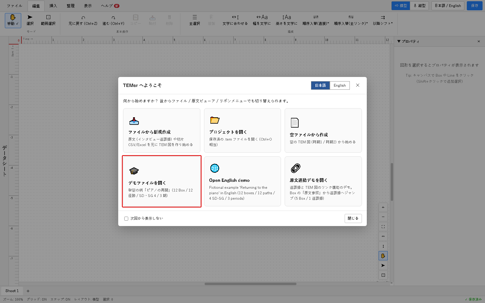

2. 架空の例「ピアノの再開」のデモが開きます（人物も出来事も作り話です）．画面の各部の名前は次のとおりです．

   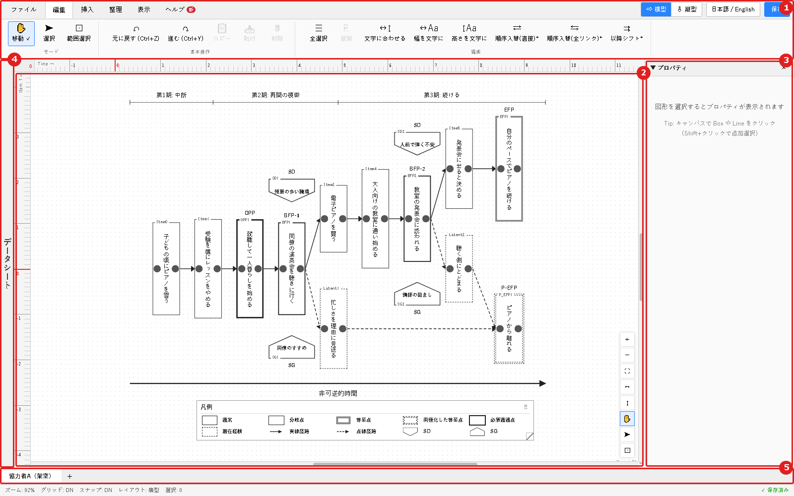

   1. リボン（タブを切り替えて，ファイル・編集・挿入などのボタンを使う）
   2. 図（ここに TEM の図を描く）
   3. プロパティ（選んだ Box や矢印の設定）
   4. データシート（押すと，Box や矢印を表の形で一覧・編集できる）
   5. シートのタブ（1 つのファイルに複数の図を持てる）

## 3. 新しい図を描く

1. 「TEMer へようこそ」の画面で「空ファイルから作成」を押します．
   （すでに図を開いているときは，「ファイル」タブの「新規」でも作れます．）

   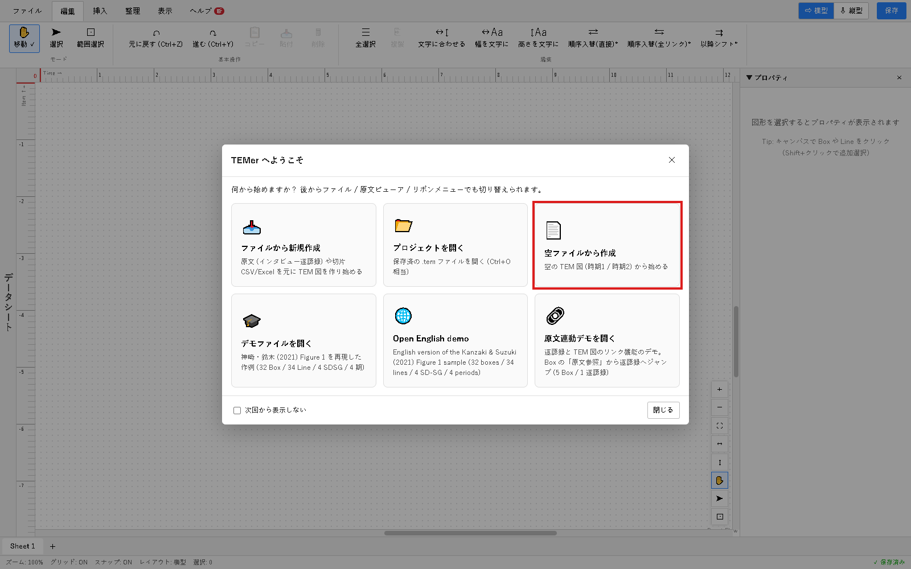

2. 「挿入」タブを開き，「行為」を押します（画像は前の名前の「通常」のままです）．

   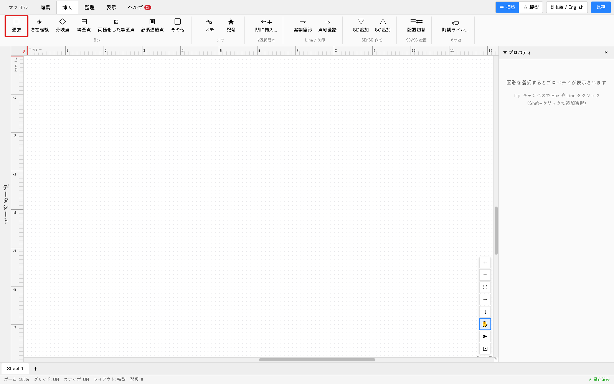

3. 図に Box が 1 つ増えます．

   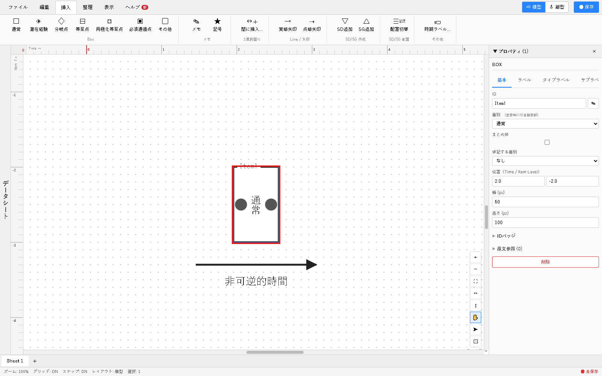

4. Box をダブルクリックすると，文字を書き換えられます（Box を選んで Enter を押しても同じです）．

   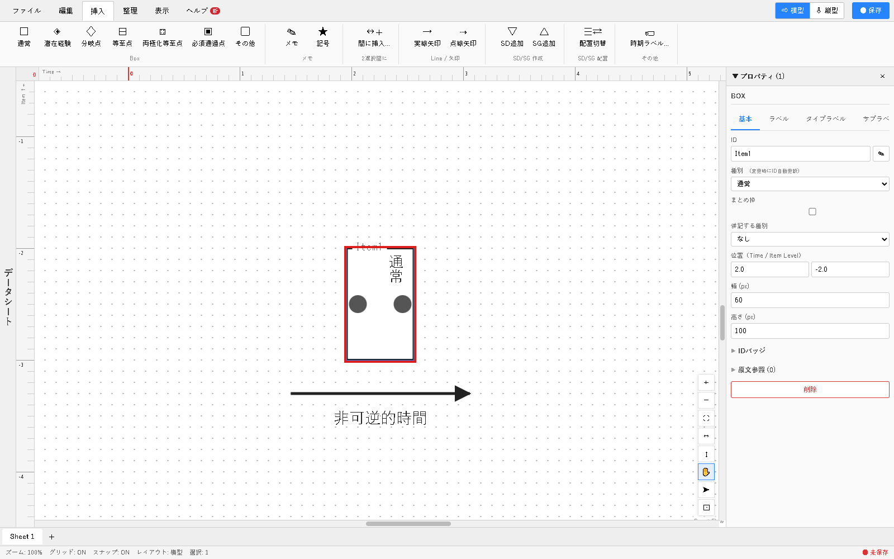

5. 経験の内容を書き込みます．横型の図では，Box の文字は縦書きで表示されます．
   書き終えたら，図の何もないところをクリックします．

   

6. 同じように，「必須通過点」などの種類の Box を足します．種類（行為・分岐点・等至点・両極化した等至点・必須通過点など）ごとに，枠の線が変わります．

   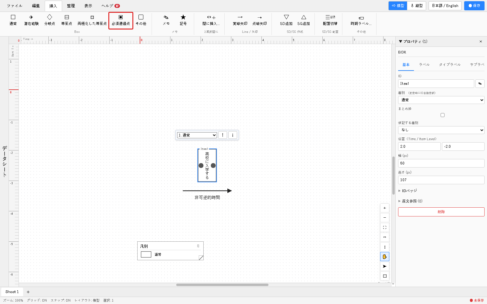

7. 矢印でつなぐ 2 つの Box を選びます．1 つ目をクリックし，2 つ目を **Shift を押しながら** クリックします．

   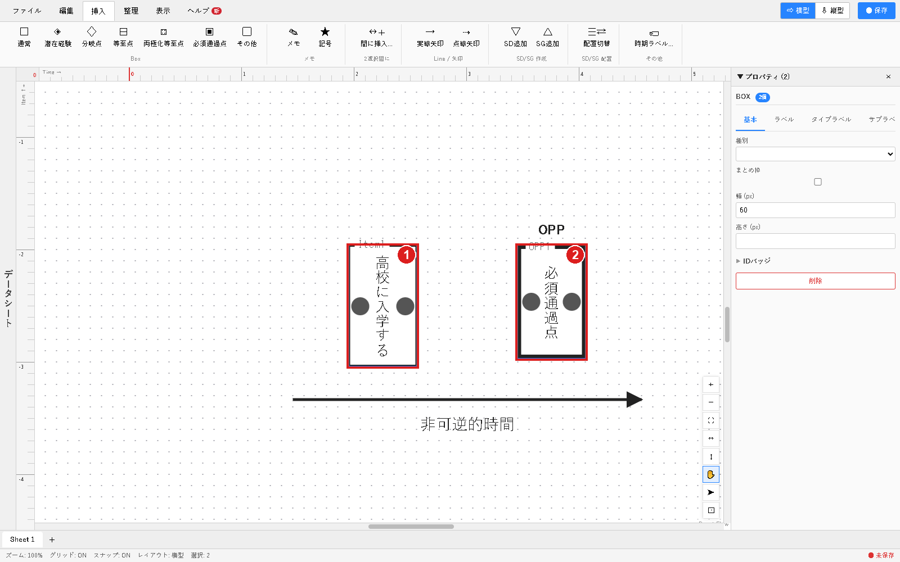

8. 「実線径路」を押します（実現しなかった径路は「点線径路」）．
   Box を 3 つ以上選ぶと，選んだ順につながります．

   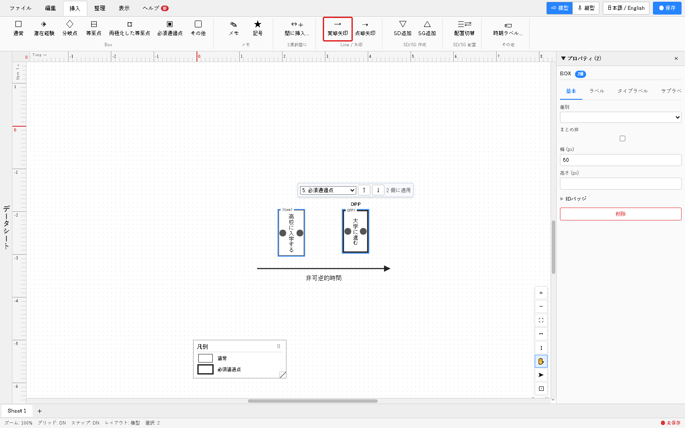

9. 2 つの Box が矢印でつながります．

   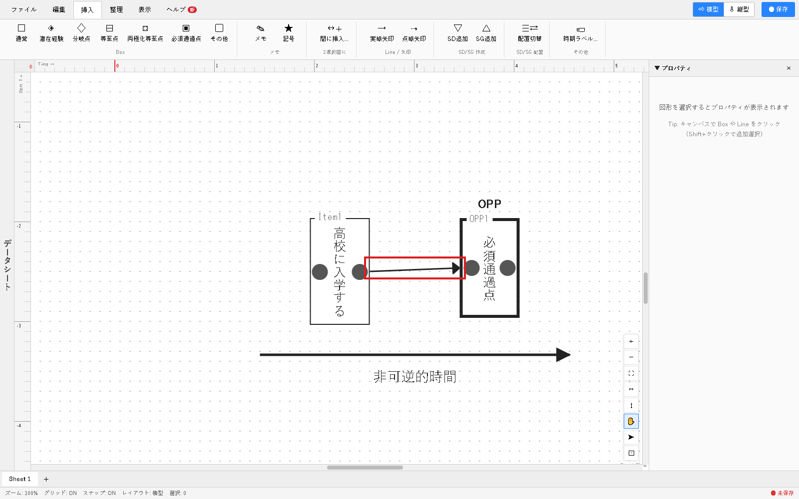

SD（社会的方向づけ）・SG（社会的助勢）や時期区分も，「挿入」タブの「SD追加」「SG追加」「時期ラベル」から足せます．
まちがえたときは，「編集」タブの「元に戻す」で戻せます（Ctrl+Z，Mac では ⌘Z）．

### 横型と縦型を切り替える

時間が右へ流れる「横型」と，下へ流れる「縦型」を，右上の「横型」「縦型」で切り替えられます．
Box・矢印・SD/SG・凡例は，新しい向きに合わせて置き直されます．
切り替えたあとは，図の右下の「全体フィット」（⛶）を押すと，図の全体が画面に入ります．

ほかにできることは，[機能の一覧](features.ja.md) にまとめています．

## 4. 保存する

右上の「保存」を押します（Ctrl+S，Mac では ⌘S）．図は `.tem` という形式のファイルに保存されます．

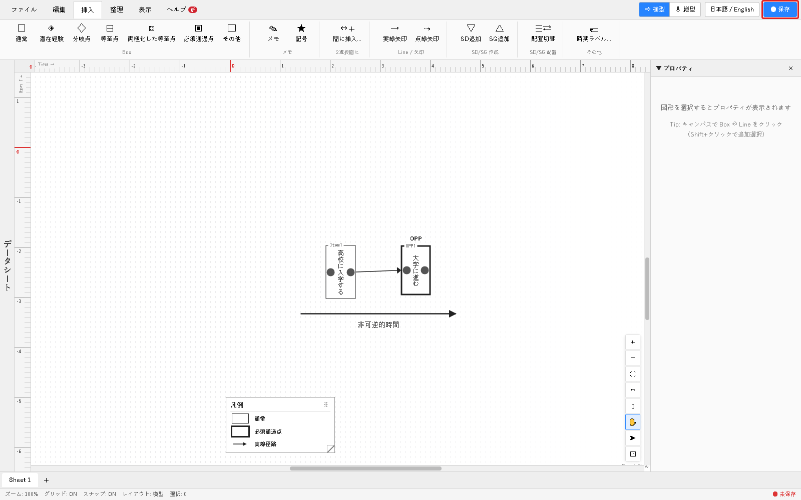

- **Chrome・Edge**: 1 回目は保存する場所と名前を聞かれます．2 回目からは，そのファイルに上書きされます．
- **Safari・Firefox**: 保存のたびに，ダウンロードのフォルダに `.tem` ファイルができます．Safari では，初めてのときに「ダウンロードを許可しますか」と聞かれるので，「許可」を押します．

保存したファイルは，「TEMer へようこそ」の「プロジェクトを開く」か，「ファイル」タブの「開く」で開けます．
保存していない変更は，ブラウザの中にも自動で残ります．次に開いたときに「復元しますか」と聞かれたら，「OK」で続きから始められます．

## 5. 画像や PowerPoint にする

1. 「ファイル」タブの「出力...」を押します．

   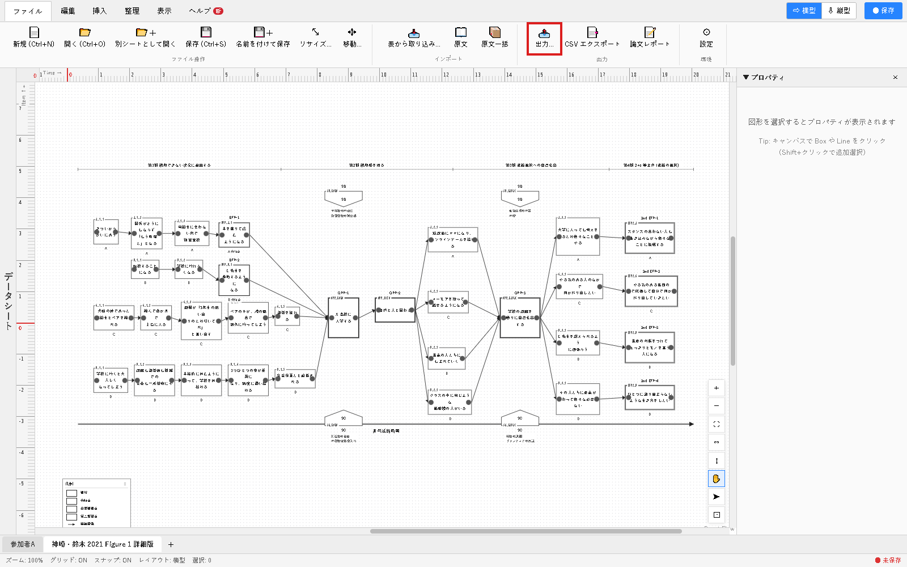

2. 出力の画面が出ます．

   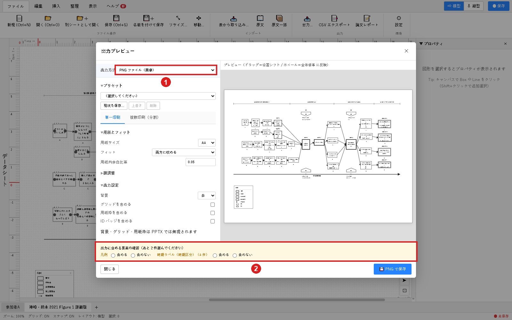

   1. 出力方式（PNG・SVG・PDF・PPTX〔PowerPoint〕・プリンターで印刷）を選びます．
   2. 凡例や時期ラベルなどを図に含めるかを，毎回選びます．選び終えるまで保存できません．

   用紙の大きさや，複数ページに分けるかも，この画面で選べます．右側に，出力される図のプレビューが出ます．

3. 選び終えたら，右下のボタン（「PNG で保存」など）を押します．

   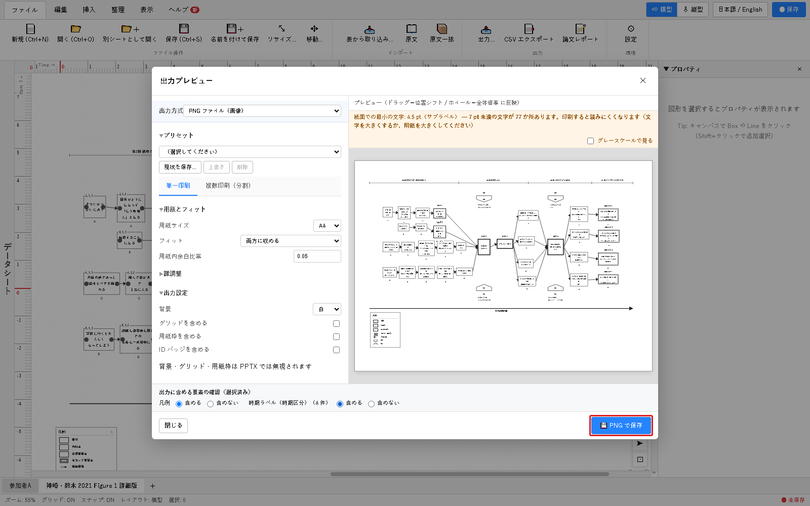

Safari で「プリンターで印刷」を選んだときは，印刷の画面で用紙の向き（「横」など）を自分で選んでください．

## 6. 論文用のレポート（Word）にする

論文の方法や結果を書くための材料を，Word のファイルにまとめられます．記号の意味（記号体系の宣言）・表記方針・図・各 Box や矢印の説明が入ります．

1. 「ファイル」タブの「論文レポート」を押します．

   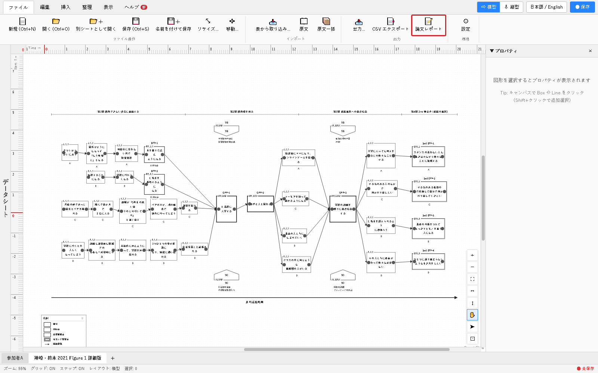

2. 「概要」「記号体系」「協力者」「インタビュー」「表記方針」の各タブに，必要なことを書き込みます（書かなくても出力できます）．書き終えたら「出力」タブを押します．

   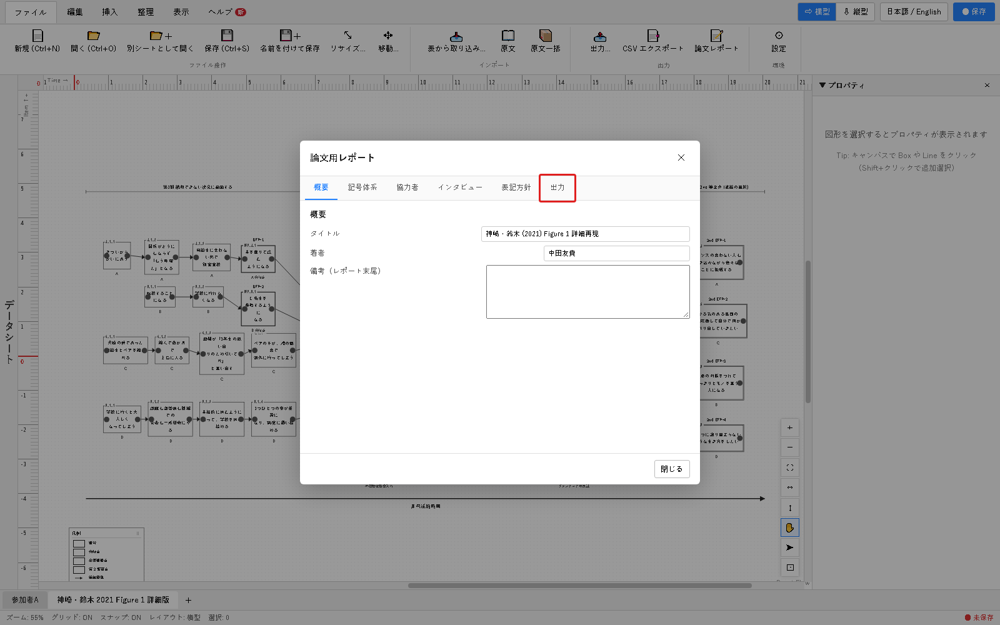

3. 「レポートを生成...」を押します．出力の前に，項目ごとの入力状況と，未入力の項目をレポートに含めるかを確かめる画面が出ます．「このまま出力する」を押すと，Word のファイルができます．

   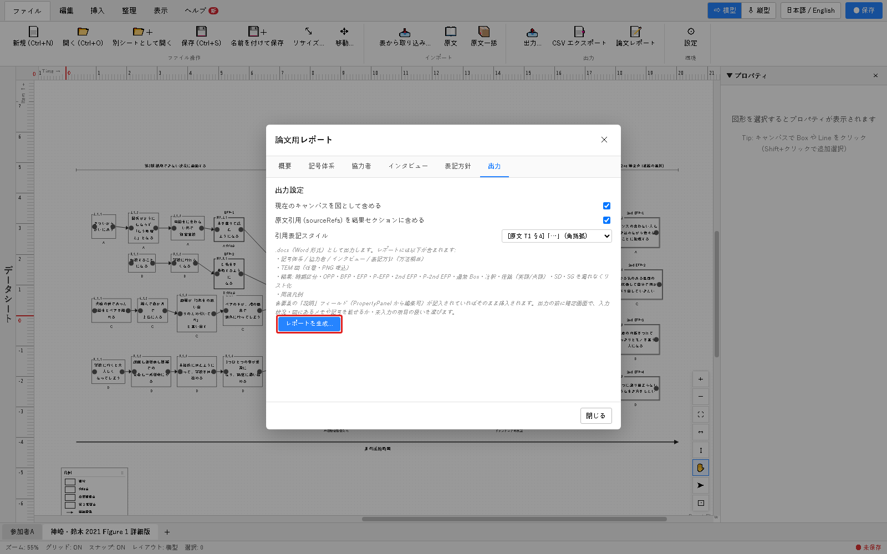

## 7. 困ったとき

「ヘルプ」タブから，最初の画面（起動ウィザード）を開き直したり，更新情報を見たりできます．「GitHub」と「作者のページ」で，リポジトリと作者の Web ページを開けます．

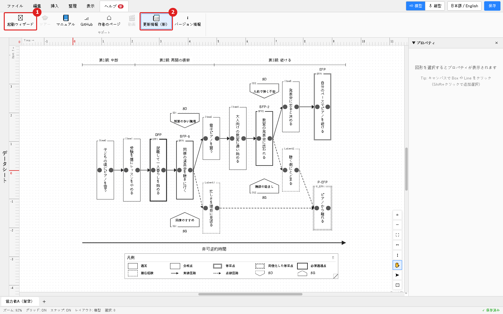

- 図が画面からはみ出したときは，図の右下のボタン（全体を表示）で全体を見られます．
- 講習会の資料（TEA 2026，スライドと練習用のファイル）も使えます: https://yukiinouenakata.github.io/tea2026/
- うまく動かないときは，[Issues](https://github.com/YukiInoueNakata/temerplus/issues) に，使っているパソコン（Windows・Mac と版）とブラウザ，起きたことを書いて知らせてください．
